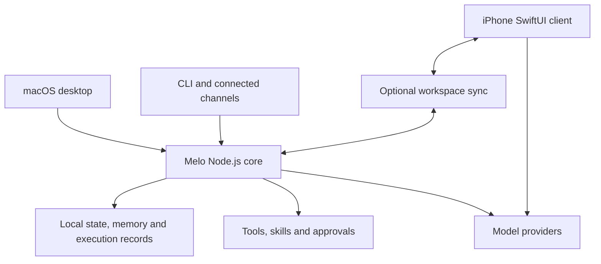

<p align="center">
  
</p>

<h1 align="center">Melo</h1>
<p align="center"><strong>Your models, your memory, your workspace.</strong></p>
<p align="center">A local-first personal AI workspace for macOS and iPhone.</p>
<p align="center">English · <a href="README.zh-CN.md">简体中文</a></p>

Melo brings conversations, projects, persistent memory, and tool-driven work into one personal workspace. A neural interface connects the macOS desktop, a native iPhone client, and a terminal interface.

Connect the models you use. Keep your working context locally. Let Melo read, search, create, and execute tasks through its own tools and approval flow.

> **Development status:** Melo is actively developed. The desktop is the main execution environment; the iPhone client has its own conversation and model connection path. Features, provider support, and device validation vary by platform.

## What you can do

| Capability | In Melo |
| --- | --- |
| **Work across conversations and projects** | Organize chats, project instructions, reference material, custom agent roles, and conversation-level model choices. |
| **Connect multiple model providers** | Use supported Codex OAuth connections, OpenAI-compatible APIs, Anthropic Messages, OpenRouter, or a local/custom model endpoint. Melo owns the task loop and tool execution. |
| **Recall relevant context** | Search local history and use scoped memory backed by SQLite, keyword retrieval, and an embedded multilingual semantic model. Inspect, edit, or forget stored facts. |
| **Act on your desktop workspace** | Read and edit files, run commands, research the web, use browser tools, and invoke reusable skills or configured MCP tools, subject to permissions and available dependencies. |
| **Work with media** | Use supported image understanding, generation/editing, document reading, voice input, and speech output. Availability depends on the configured engine, model, and account. |
| **Inspect task execution** | Review model and tool events, sources, results, and saved execution history in the neural task space. Provider-supplied metadata is shown when available. |

### Desktop, iPhone, and CLI

- **macOS:** a native Swift shell around the local workspace, with a JavaScript UI, neural navigation, and the Node.js execution core.
- **iPhone:** a native SwiftUI client for conversations, model connections, roles, drafts, image workflows, and optional workspace synchronization. Independent chat can use its own model connection while the Mac is off; desktop tool execution still needs the desktop runtime.
- **CLI:** interactive chat, single prompts, history search, memory status, and runtime diagnostics through the same local codebase.
- **Connected channels:** Telegram and Discord integrations can route configured channels into Melo. They require explicit setup and a running runtime.

Synchronization is configured separately from model access. It is not an automatic hosted service, and mobile does not have every desktop tool.

## Architecture

Melo uses a modular Node.js core for desktop, CLI, and connected channels. The iPhone client has its own native conversation path and can exchange workspace data through the optional sync service.



| Directory | Responsibility |
| --- | --- |
| `desktop-app/` | Native macOS shell and lifecycle |
| `desktop-ui/` | Chat UI, settings, neural navigation, and execution views |
| `src/services/`, `src/runtime/` | Application services, request scope, scheduling, and task lifecycle |
| `src/providers/`, `src/openai.js` | Model connections, protocols, and response handling |
| `src/tools/`, `src/safety/`, `src/agents/` | Tools, permissions, agent roles, skills, and delegated work |
| `src/memory/`, `src/state/`, `src/persistence/` | Retrieval, local state, checkpoints, and persistence |
| `ios/`, `mobile-sync/`, `shared/` | iPhone client, synchronization protocol, and shared rendering/contracts |

## Run from source

### Requirements

- **macOS 13 or newer** for the desktop app.
- **Node.js 22.13 or newer**; Node 22 LTS is the recommended development baseline. Melo uses `node:sqlite` and native dependencies, so the older `>=18` package declaration is not sufficient for this setup.
- **Xcode Command Line Tools** for native dependencies and the Swift desktop build. iPhone development requires Xcode, an appropriate iOS SDK, and signing for a physical device.
- A configured model connection for inference. Service access and any usage charges belong to the selected provider/account.

### macOS desktop

```bash
git clone https://github.com/MortredVigoss/Melo.git
cd Melo
npm ci
npm run build
npm run build:desktop
npm run install:desktop
open "$HOME/Applications/Melo.app"
```

The desktop build prepares checksum-pinned local embedding assets; the first build may download them. The install script replaces `~/Applications/Melo.app` with the local build.

In Melo, open **System → Models**, configure a provider and model, test the connection, and activate it. A text connection does not establish image-generation or tool capabilities for that provider.

### Terminal

After configuring your connection:

```bash
node src/index.js doctor
node src/index.js
node src/index.js chat "Summarize the project I am working on."
```

For a compatible API endpoint, you can also set `MELO_AUTH_MODE=api-key`, `MELO_API_KEY`, `MELO_BASE_URL`, and `MELO_MODEL` in your environment. Use a model ID your endpoint actually exposes.

## Local data and memory

Desktop and CLI use `.tmp/melo-home-user/` inside the checkout by default. Set `MELO_HOME` or pass `--home` to choose a separate data directory:

```bash
node src/index.js --home /path/to/separate-melo-data doctor
```

The data home contains user state, not just caches. Preserve it when updating or moving an installation. Model credentials and cloud inference are separate from local storage: selected content is sent to your configured provider when you make a model request.

Semantic recall uses bundled, quantized **multilingual-e5-small** through an ONNX worker. Inference for that embedding model runs locally; Ollama is optional rather than a prerequisite. Keyword retrieval remains available while model assets or indexes are unavailable. See the [memory architecture](docs/memory-architecture.md) for current scope and retrieval rules; older phase notes are marked as historical.

## Permissions and integrations

File and command tools follow Melo's permission and workspace rules. MCP servers are opt-in and require separate configuration and agent authorization. An approved third-party process can have broader local access; approval dialogs are not an operating-system sandbox.

Provider connections, image engines, synchronization, and remote channels are independently configured. Real-account availability, background behavior on iOS, and third-party service limits need validation in the environment where you use them.

## Development and validation

```bash
npm run test:plan    # inspect the daily verification plan
npm test             # daily checks selected by change boundary
npm run test:full    # full release verification
```

The full gate includes build/install and native launch stages. Use the [testing workflow](docs/testing-workflow.md) to choose the appropriate checks. Unit or mock-provider tests, real service requests, application installation, and physical-device acceptance are separate evidence.

## Explore the project

- [Backend architecture](docs/backend-architecture.md)
- [Model connections and provider boundaries](docs/llm-connections.md)
- [Memory architecture](docs/memory-architecture.md)
- [Native function calling](docs/function-calling-20261014.md)
- [UI design language](docs/ui-design-language.md)
- [Image engine setup](docs/generation-setup.md)
- [iPhone source and development notes](ios/README.md)
- [Testing workflow](docs/testing-workflow.md)

For a bug report, include your platform, setup steps, and reproducible behavior. Remove credentials and private conversations from logs before sharing them through [GitHub Issues](https://github.com/MortredVigoss/Melo/issues).
