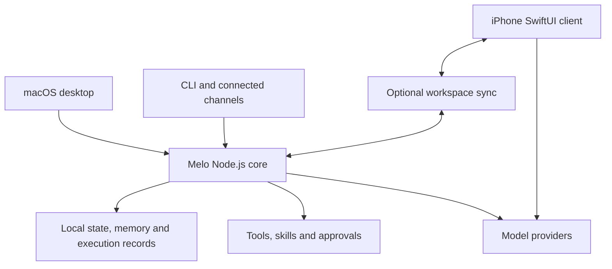

<p align="center">
  
</p>

<h1 align="center">Melo</h1>
<p align="center"><strong>Your models, your memory, your workspace.</strong></p>
<p align="center">A local-first AI workspace for macOS and iPhone, built to work with the models and tools you choose.</p>

Melo brings conversations, projects, persistent memory, and tool-driven work into one personal workspace. A neural interface connects the macOS desktop, a native iPhone client, and a terminal interface.

Connect Claude through Anthropic Messages, use supported OpenAI and OpenAI-compatible connections, or bring a local model endpoint. Keep your working context locally and connect your tools through MCP, reusable skills, and Melo's approval flow.

> **Development status:** Melo is actively developed. The desktop is the main execution environment; the iPhone client has its own conversation and model connection path. Features, provider support, and device validation vary by platform.

## What you can do

| Capability | In Melo |
| --- | --- |
| **Work across conversations and projects** | Organize chats, project instructions, reference material, Agents, and conversation-level model choices. |
| **Connect multiple model providers** | Use supported Codex OAuth connections, OpenAI-compatible APIs, Claude through Anthropic Messages, OpenRouter, or a local/custom model endpoint. Keep provider and model choices configurable. |
| **Collaborate with Agents** | Configure each Agent's instructions, model, and capabilities. Delegate work or run sequential, parallel-research, and review teams with structured handoffs. Desktop tools and iPhone text teams follow their platform-specific capability limits. |
| **Separate knowledge from results** | Save reference documents as knowledge, retrieve relevant passages locally, and keep automatically extracted code blocks in a separate results collection. |
| **Recall relevant context** | Search local history and use scoped memory backed by SQLite, keyword retrieval, and an embedded multilingual semantic model. Inspect, edit, or forget stored facts. |
| **Act on your desktop workspace** | Read and edit files, run commands, research the web, use browser tools, and invoke reusable skills or configured MCP tools, subject to permissions and available dependencies. |
| **Work with media** | Use supported image understanding, generation/editing, document reading, voice input, and speech output. Availability depends on the configured engine, model, and account. |
| **Inspect task execution** | Review model and tool events, sources, results, and saved execution history in the neural task space. View live elapsed time, completion timestamps, and image progress based on saved results. Provider-supplied metadata is shown when available. |

### Compatibility and connections

Melo works alongside the model and tool ecosystems you already use. Choose a provider for each workflow while keeping your conversations, Agent settings, and saved context in one workspace.

| Connection | Supported integration |
| --- | --- |
| **Anthropic / Claude** | Anthropic Messages API with an API key, including streamed text responses. |
| **OpenAI** | OpenAI-compatible API connections and supported Codex OAuth access through their respective request paths. |
| **OpenRouter** | API key or supported browser authorization, with the models available to that account. |
| **Other hosted providers** | OpenAI-compatible Chat Completions endpoints, including configured connections for DeepSeek, Gemini, Kimi, Qwen, and Doubao. |
| **Local and custom models** | A reachable endpoint implementing a supported Chat Completions or Anthropic Messages protocol. |
| **Tools and services** | MCP servers, reusable skills, and configured Discord channels, subject to Agent capabilities and permissions. |

Protocol compatibility is the starting point: model access, attachments, tool calling, and image generation depend on the selected endpoint and account. Use the connection tests in Melo to check your setup. API credentials, supported OAuth access, and consumer subscriptions have their own access requirements. See [model connections](docs/llm-connections.md) for implementation and validation details.

### Desktop, iPhone, and CLI

- **macOS:** a native Swift shell around the local workspace, with a JavaScript UI, neural navigation, and the Node.js execution core.
- **iPhone:** a native SwiftUI client for concurrent conversations, model connections, Agents, text teams, drafts, image workflows, and optional workspace synchronization. Independent chat can use its own model connection while the Mac is off; desktop tool execution still needs the desktop runtime.
- **CLI:** interactive chat, single prompts, history search, memory status, and runtime diagnostics through the same local codebase.
- **Connected channels:** Discord can route configured channels into Melo. It requires explicit setup and a running runtime. Telegram is temporarily archived; its saved configuration and conversation history are preserved.

Synchronization is configured separately from model access. It is not an automatic hosted service, and mobile does not have every desktop tool.

The optional Agent capability sync extension preserves the existing conversation sync protocol. Older sync servers can continue syncing conversations while capability settings remain pending; showing those settings on iPhone requires an updated private sync server and client. iPhone teams run directly on the phone using those collaboration settings: members make text requests, search requires local permission for both the lead and member, and the lead summarizes their handoffs. The shared time budget also covers that summary. Phone teams do not run desktop file/command tools or provide the desktop token-budget accounting; project default teams remain desktop-local.

## Architecture

Melo uses a modular Node.js core for desktop, CLI, and connected channels. The iPhone client has its own native conversation path and can exchange workspace data through the optional sync service.



| Directory | Responsibility |
| --- | --- |
| `desktop-app/` | Native macOS shell and lifecycle |
| `desktop-ui/` | Chat UI, settings, neural navigation, and execution views |
| `src/services/`, `src/runtime/` | Application services, request scope, scheduling, and task lifecycle |
| `src/providers/`, `src/openai.js` | Model connections, protocols, and response handling |
| `src/tools/`, `src/safety/`, `src/agents/` | Tools, permissions, Agents, skills, and delegated work |
| `src/memory/`, `src/state/`, `src/persistence/` | Retrieval, local state, checkpoints, and persistence |
| `ios/`, `mobile-sync/`, `shared/` | iPhone client, synchronization protocol, and shared rendering/contracts |

## Run from source

### Requirements

- **macOS 13 or newer** for the desktop app.
- **Node.js 22.13 or newer**; Node 22 LTS is the recommended development baseline. Melo uses `node:sqlite` and native dependencies, so the older `>=18` package declaration is not sufficient for this setup.
- **Xcode Command Line Tools** for native dependencies and the Swift desktop build. iPhone development requires Xcode, an appropriate iOS SDK, and signing for a physical device.
- A configured model connection for inference. Service access and any usage charges belong to the selected provider/account.

### macOS desktop

```bash
git clone https://github.com/MortredVigoss/Melo.git
cd Melo
npm ci
npm run build
npm run build:desktop
npm run install:desktop
open "$HOME/Applications/Melo.app"
```

The desktop build prepares checksum-pinned local embedding assets; the first build may download them. The install script replaces `~/Applications/Melo.app` with the local build.

In Melo, open **System → Models**, configure a provider and model, test the connection, and activate it. A text connection does not establish image-generation or tool capabilities for that provider.

### Terminal

After configuring your connection:

```bash
node src/index.js doctor
node src/index.js
node src/index.js chat "Summarize the project I am working on."
```

For a compatible API endpoint, you can also set `MELO_AUTH_MODE=api-key`, `MELO_API_KEY`, `MELO_BASE_URL`, and `MELO_MODEL` in your environment. Use a model ID your endpoint actually exposes.

## Local data and memory

Desktop and CLI use `.tmp/melo-home-user/` inside the checkout by default. Set `MELO_HOME` or pass `--home` to choose a separate data directory:

```bash
node src/index.js --home /path/to/separate-melo-data doctor
```

The data home contains user state, not just caches. Preserve it when updating or moving an installation. Model credentials and cloud inference are separate from local storage: selected content is sent to your configured provider when you make a model request.

Semantic recall uses bundled, quantized **multilingual-e5-small** through an ONNX worker. Inference for that embedding model runs locally; Ollama is optional rather than a prerequisite. Keyword retrieval remains available while model assets or indexes are unavailable. See the [memory architecture](docs/memory-architecture.md) for current scope and retrieval rules; older phase notes are marked as historical.

## Permissions and integrations

File and command tools follow Melo's permission and workspace rules. Built-in MCP services can start with the desktop; Agent capabilities and tool approvals govern their use. Additional MCP servers require configuration, and service switches remain editable. An approved third-party process can have broader local access; approval dialogs are not an operating-system sandbox.

On iPhone, calendar, reminders, contacts, and location access is opt-in on that device, with separate per-Agent grants and iOS permission checks. Writes require confirmation. These grants stay local and are not copied from desktop permissions. Availability is limited to the supported ChatGPT connection path; API and image requests do not gain system-data tools.

Image requests use natural conversation instructions, including edits with a reference photo; no separate image mode is required. Saved-image counts show actual completed results, not an invented percentage for a provider that reports no internal progress.

Provider connections, image engines, synchronization, and remote channels are independently configured. Real-account availability, background behavior on iOS, and third-party service limits need validation in the environment where you use them.

## Development and validation

```bash
npm run test:plan    # inspect the daily verification plan
npm test             # daily checks selected by change boundary
npm run test:full    # full release verification
```

The full gate includes build/install and native launch stages. Use the [testing workflow](docs/testing-workflow.md) to choose the appropriate checks. Unit or mock-provider tests, real service requests, application installation, and physical-device acceptance are separate evidence.

## Explore the project

- [Backend architecture](docs/backend-architecture.md)
- [Model connections and provider boundaries](docs/llm-connections.md)
- [Memory architecture](docs/memory-architecture.md)
- [Native function calling](docs/function-calling-20261014.md)
- [UI design language](docs/ui-design-language.md)
- [Image engine setup](docs/generation-setup.md)
- [iPhone source and development notes](ios/README.md)
- [Testing workflow](docs/testing-workflow.md)

For a bug report, include your platform, setup steps, and reproducible behavior. Remove credentials and private conversations from logs before sharing them through [GitHub Issues](https://github.com/MortredVigoss/Melo/issues).
