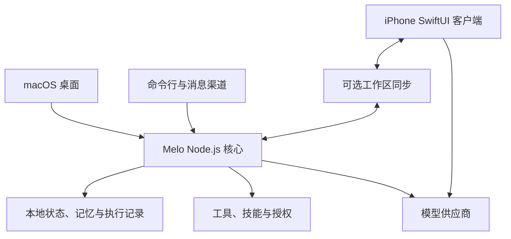

<p align="center">
  
</p>

<h1 align="center">Melo</h1>
<p align="center"><strong>你的模型、记忆与工作空间。</strong></p>
<p align="center">面向 macOS 与 iPhone 的本地优先个人 AI 执行工作区。</p>
<p align="center"><a href="README.md">English</a> · 简体中文</p>

Melo 将对话、项目、长期记忆和工具执行放进同一个个人工作空间，以神经网络界面连接 macOS 桌面、原生 iPhone 客户端和命令行。

连接你使用的模型，把工作上下文保存在本地，通过 Melo 自己的工具和授权流程完成读取、检索、创作与执行。

> **开发状态：** Melo 持续开发中。桌面是主要执行环境；iPhone 有独立的对话与模型连接链路。不同平台的功能、供应商支持和设备验证进度有所不同。

## Melo 能做什么

| 能力 | 使用方式 |
| --- | --- |
| **组织对话与项目** | 管理聊天、项目指令、参考资料、自定义角色和对话级模型选择。 |
| **连接多个模型平台** | 使用支持的 Codex OAuth、OpenAI 兼容 API、Anthropic Messages、OpenRouter 或本地/自定义模型服务；任务循环和工具执行由 Melo 负责。 |
| **找回相关上下文** | 检索本地历史，以 SQLite、关键词检索和内置多语言语义模型调用有作用域的记忆；可查看、编辑与遗忘事实。 |
| **在桌面工作区执行任务** | 读取和编辑文件、执行命令、检索网页、使用浏览器、复用技能或调用已配置的 MCP 工具，受权限和运行依赖约束。 |
| **处理图片、文档和语音** | 接入支持的图片理解、生成与编辑、文档读取、语音输入及朗读；具体可用性取决于引擎、模型和账户。 |
| **查看任务执行过程** | 在神经任务空间查看模型与工具事件、来源、结果和历史记录；仅在服务实际提供时显示相应元数据。 |

### 桌面、iPhone 与命令行

- **macOS：** 原生 Swift 外壳承载本地工作区，内部使用 JavaScript 界面、神经导航和 Node.js 执行核心。
- **iPhone：** 原生 SwiftUI 客户端，包含对话、模型连接、角色、草稿、图片工作流及可选工作区同步。使用手机自己的连接时，Mac 关机仍可独立聊天；桌面工具执行仍需要桌面运行时。
- **命令行：** 同一套本地代码提供交互聊天、单次提问、历史检索、记忆状态和运行诊断。
- **消息渠道：** 可配置 Telegram、Discord 将指定渠道接入 Melo，需要明确设置并保持运行时在线。

工作区同步与模型登录分别配置；同步服务需要自行部署，手机也未覆盖全部桌面工具能力。

## 架构

桌面、命令行和消息渠道共享模块化 Node.js 核心。iPhone 保留独立的原生对话链路，通过可选同步服务交换工作区数据。



| 目录 | 职责 |
| --- | --- |
| `desktop-app/` | macOS 原生外壳与生命周期 |
| `desktop-ui/` | 聊天、设置、神经导航与执行视图 |
| `src/services/`、`src/runtime/` | 业务服务、请求作用域、调度与任务生命周期 |
| `src/providers/`、`src/openai.js` | 模型连接、协议和响应处理 |
| `src/tools/`、`src/safety/`、`src/agents/` | 工具、权限、角色、技能及委派任务 |
| `src/memory/`、`src/state/`、`src/persistence/` | 检索、本地状态、检查点与持久化 |
| `ios/`、`mobile-sync/`、`shared/` | iPhone 客户端、同步协议、共享渲染和契约 |

## 从源码运行

### 环境要求

- 桌面应用需要 **macOS 13 或更新版本**。
- **Node.js 22.13 或更新版本**，建议使用 Node 22 LTS。Melo 使用 `node:sqlite` 与原生依赖，当前 package 中较旧的 `>=18` 声明不足以满足这里的运行要求。
- 原生依赖和 Swift 桌面构建需要 **Xcode Command Line Tools**；iPhone 开发需要 Xcode、对应 iOS SDK，实体设备还需要签名。
- 模型推理需要自行配置可用连接，服务访问权限与使用费用由所选供应商和账户决定。

### macOS 桌面

```bash
git clone https://github.com/MortredVigoss/Melo.git
cd Melo
npm ci
npm run build
npm run build:desktop
npm run install:desktop
open "$HOME/Applications/Melo.app"
```

桌面构建会准备经过校验的本地 embedding 模型，首次构建可能下载模型资产。安装脚本会使用本地构建替换 `~/Applications/Melo.app`。

启动后进入 **系统 → 模型**，填写供应商与模型，测试实际连接后启用。文字连接成功与该供应商的图片生成或工具能力分别验证。

### 命令行

配置好模型连接后：

```bash
node src/index.js doctor
node src/index.js
node src/index.js chat "总结一下我正在处理的项目。"
```

兼容 API 也可通过环境变量设置 `MELO_AUTH_MODE=api-key`、`MELO_API_KEY`、`MELO_BASE_URL` 和 `MELO_MODEL`。模型 ID 需要是该服务实际提供的型号。

## 本地数据与记忆

桌面与命令行默认共用仓库内的 `.tmp/melo-home-user/`。可设置 `MELO_HOME` 或使用 `--home` 选择独立数据目录：

```bash
node src/index.js --home /path/to/separate-melo-data doctor
```

数据目录包含用户状态与历史，更新或迁移时应保留。模型凭证、云端推理和本地存储是不同边界：发起模型请求时，选中的内容会发送到你配置的模型供应商。

语义记忆使用内置量化 **multilingual-e5-small** 和 ONNX worker，在本机推理；Ollama 是可选后端，无须先安装独立服务。模型资产或索引暂不可用时仍可使用关键词检索。现行作用域与检索约定见[记忆架构](docs/memory-architecture.md)，其中旧阶段说明已标记为历史内容。

## 权限与集成

文件与命令工具遵循 Melo 的授权和工作区规则。MCP 服务需要主动启用、单独配置及角色授权；获准运行的第三方进程可能拥有更广的本机访问能力，授权弹窗本身不构成操作系统沙箱。

模型连接、图片引擎、同步服务与远程渠道独立配置。真实账户权限、iOS 后台行为和第三方服务限制，需要在实际使用环境分别验证。

## 开发与验证

```bash
npm run test:plan    # 查看日常检查计划
npm test             # 按改动边界执行日常检查
npm run test:full    # 完整发布验证
```

完整 gate 包含构建、安装和原生启动阶段。按[测试工作流](docs/testing-workflow.md)选择检查范围；单元/模拟服务测试、真实服务调用、安装和实体设备验收分别记录。

## 进一步了解

- [后端架构](docs/backend-architecture.md)
- [模型连接与供应商边界](docs/llm-connections.md)
- [记忆架构](docs/memory-architecture.md)
- [原生 Function Calling](docs/function-calling-20261014.md)
- [UI 设计语言](docs/ui-design-language.md)
- [图片引擎配置](docs/generation-setup.md)
- [iPhone 源码与开发记录](ios/README.md)
- [测试工作流](docs/testing-workflow.md)

反馈问题时请提供平台、配置步骤和可复现行为；通过 [GitHub Issues](https://github.com/MortredVigoss/Melo/issues)分享日志前移除凭证和私人对话。
